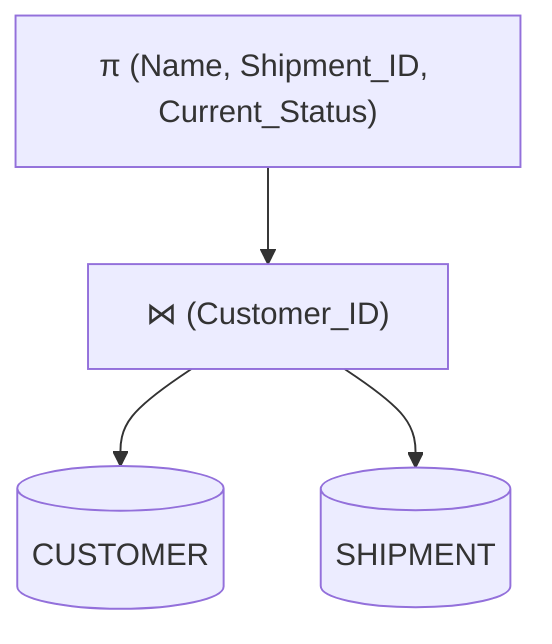
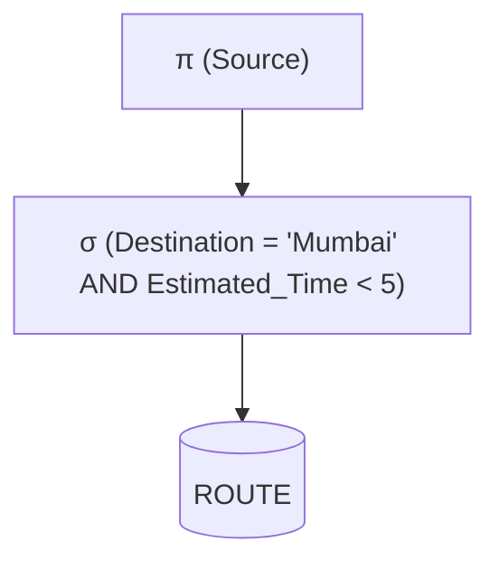

# Relational Algebra Mapping

## 1. Relational Algebra Operations
Relational algebra is a procedural query language forming the theoretical foundation of SQL.
- **Selection ($\sigma$):** Filters rows based on a condition (SQL `WHERE`).
- **Projection ($\pi$):** Selects specific columns (SQL `SELECT`).
- **Union ($\cup$):** Combines tuples of two compatible relations.
- **Intersection ($\cap$):** Returns tuples present in both relations.
- **Difference ($-$):** Returns tuples in the first but not the second relation.
- **Cartesian Product ($\times$):** Combines every tuple of relation A with every tuple of relation B.
- **Natural Join ($\bowtie$):** Joins relations on attributes with the same name.
- **Theta Join ($\bowtie_{\theta}$):** Joins based on a specific condition.
- **Rename ($\rho$):** Renames relations or attributes.

## 2. Project SQL to Relational Algebra Translations

**Query 1: Find customer by ID**
```sql
SELECT Name, Email FROM CUSTOMER WHERE Customer_ID = 1001;
```
**RA:** $\pi_{Name, Email}(\sigma_{Customer\_ID = 1001}(CUSTOMER))$

**Query 2: Customer shipment history**
```sql
SELECT c.Name, s.Shipment_ID, s.Current_Status 
FROM CUSTOMER c JOIN SHIPMENT s ON c.Customer_ID = s.Customer_ID;
```
**RA:** $\pi_{Name, Shipment\_ID, Current\_Status}(CUSTOMER \bowtie_{Customer\_ID} SHIPMENT)$

**Query 3: Active shipments in a warehouse**
```sql
SELECT * FROM SHIPMENT WHERE Warehouse_ID = 3000 AND Current_Status != 'DELIVERED';
```
**RA:** $\sigma_{Warehouse\_ID = 3000 \land Current\_Status \neq 'DELIVERED'}(SHIPMENT)$

**Query 4: Delivery agent with employee info**
```sql
SELECT e.Name, da.License_No 
FROM EMPLOYEE e JOIN DELIVERY_AGENT da ON e.Employee_ID = da.Employee_ID;
```
**RA:** $\pi_{Name, License\_No}(EMPLOYEE \bowtie_{Employee\_ID} DELIVERY\_AGENT)$

**Query 5: Find all vehicles that are TRUCKS and available**
```sql
SELECT Vehicle_Number FROM VEHICLE WHERE Vehicle_Type = 'TRUCK' AND Availability = 'YES';
```
**RA:** $\pi_{Vehicle\_Number}(\sigma_{Vehicle\_Type='TRUCK' \land Availability='YES'}(VEHICLE))$

**Query 6: Get tracking details for a specific shipment**
```sql
SELECT Current_Location, Status FROM TRACKING WHERE Shipment_ID = 5001;
```
**RA:** $\pi_{Current\_Location, Status}(\sigma_{Shipment\_ID = 5001}(TRACKING))$

**Query 7: Employee names earning more than 50,000**
```sql
SELECT Name FROM EMPLOYEE WHERE Salary > 50000;
```
**RA:** $\pi_{Name}(\sigma_{Salary > 50000}(EMPLOYEE))$

**Query 8: Find routes taking less than 5 hours to a specific destination**
```sql
SELECT Source FROM ROUTE WHERE Destination = 'Mumbai' AND Estimated_Time < 5;
```
**RA:** $\pi_{Source}(\sigma_{Destination = 'Mumbai' \land Estimated\_Time < 5}(ROUTE))$

## 3. Query Trees

**Query Tree for Query 2 (Customer shipment history):**


**Query Tree for Query 8 (Filtered Route query):**


## 4. SQL to Relational Algebra Mapping

| SQL Clause / Keyword | Relational Algebra Operation | Symbol |
|----------------------|------------------------------|--------|
| `SELECT columns` | Projection | $\pi$ |
| `WHERE condition` | Selection | $\sigma$ |
| `JOIN ... ON` | Theta Join / Natural Join | $\bowtie$ |
| `UNION` | Union | $\cup$ |
| `INTERSECT` | Intersection | $\cap$ |
| `MINUS` (Oracle) / `EXCEPT` | Set Difference | $-$ |
| `FROM T1, T2` (without where)| Cartesian Product | $\times$ |
| `AS` | Rename | $\rho$ |
