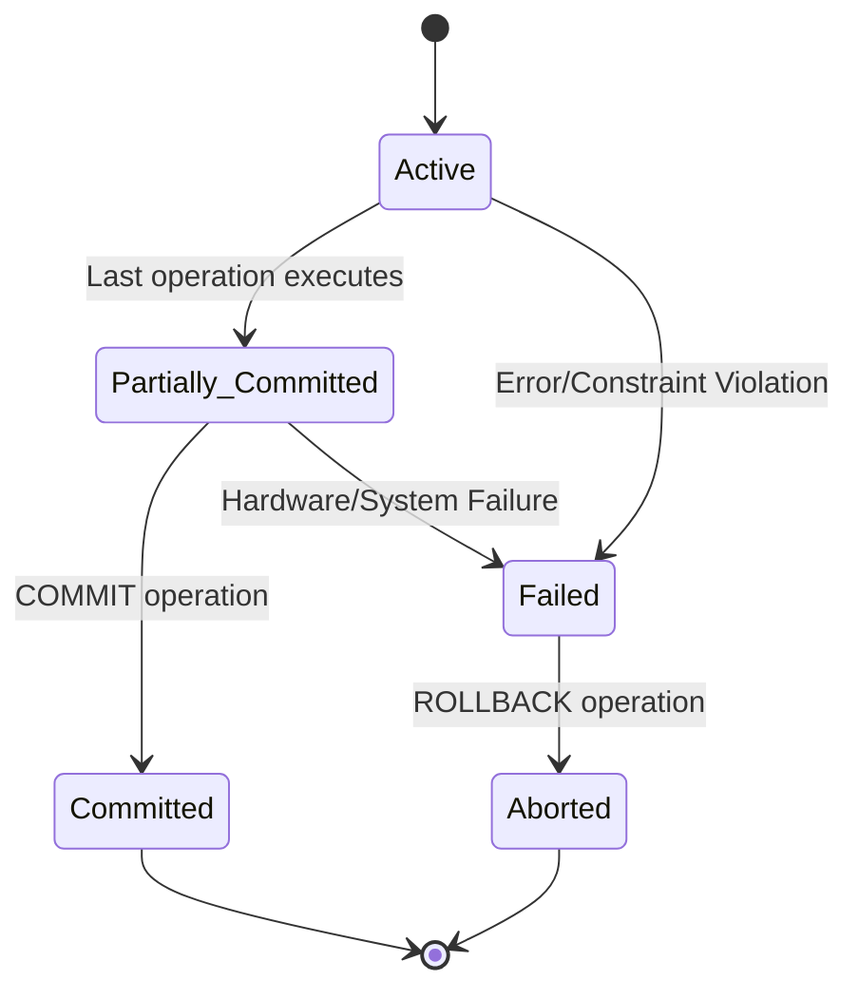

# Transaction Management and Recovery

## 1. Transaction Concepts
A database transaction is a logical unit of work consisting of one or more SQL operations. The Logistics Courier Tracking System relies on strict transaction management to maintain data integrity, governed by the ACID properties:

- **Atomicity (All-or-Nothing):** When booking a shipment, the system inserts into `SHIPMENT`, `PARCEL`, `TRACKING`, and `PAYMENT`. If the payment fails, the shipment and parcel inserts must roll back so we don't have orphaned data.
- **Consistency:** Database constraints ensure consistency. For example, a warehouse has a `Capacity`. Transactions are constrained (via triggers or application logic) from exceeding this capacity.
- **Isolation:** Multiple delivery agents updating statuses concurrently are isolated. Oracle uses Read Committed isolation by default, preventing dirty reads of uncommitted shipment statuses.
- **Durability:** Once a `COMMIT` is issued after a successful delivery update, the `DELIVERED` status is permanently stored in the Oracle redo logs and data files, surviving system crashes.

## 2. Transaction States


- **Active:** `PKG_SHIPMENT.BOOK_SHIPMENT` starts executing inserts.
- **Failed:** A `UNIQUE` constraint violation occurs on `Tracking_ID`.
- **Aborted:** The `EXCEPTION` block catches the error and issues a `ROLLBACK`.

## 3. Oracle Transaction Control
Oracle manages transactions using specific statements:
- **COMMIT:** Explicitly called in PL/SQL packages (`PKG_ADMIN`, `PKG_SHIPMENT`) to persist changes permanently.
- **ROLLBACK:** Utilized within the `EXCEPTION` handlers to undo all operations since the transaction start or a specific savepoint.
- **SAVEPOINT:** Used to set intermediate markers. If a non-critical sub-operation fails, the transaction can roll back to the savepoint without aborting the entire process.
- *Note:* Oracle does not auto-commit DML statements by default, requiring explicit `COMMIT` logic in our API/Procedures.

## 4. Project Transaction Examples

**Shipment Booking (`PKG_SHIPMENT.BOOK_SHIPMENT`):**
```plsql
PROCEDURE BOOK_SHIPMENT(
    p_customer_id IN NUMBER,
    p_warehouse_id IN NUMBER,
    ...
) IS
BEGIN
    SAVEPOINT sp_book;
    
    INSERT INTO SHIPMENT (Shipment_ID, Customer_ID, ...) VALUES (...);
    INSERT INTO PARCEL (Parcel_ID, Shipment_ID, ...) VALUES (...);
    INSERT INTO TRACKING (Tracking_ID, Shipment_ID, ...) VALUES (...);
    INSERT INTO PAYMENT (Payment_ID, Shipment_ID, ...) VALUES (...);
    
    COMMIT;
EXCEPTION
    WHEN OTHERS THEN
        ROLLBACK TO sp_book;
        RAISE;
END BOOK_SHIPMENT;
```
Similar transactional guarantees are provided during Customer Registration, Account Deletion, and Delivery Completion.

## 5. Serializability
Serializability ensures that the concurrent execution of transactions yields the same state as if they were executed serially.
- **Conflict Serializability:** If two transactions modify the same shipment status, the database ensures the updates are serialized (using row-level locking).
- **Project Scenario:** Two warehouse staff members try to assign the same shipment to different delivery agents. The first `UPDATE` acquires a row lock. The second transaction blocks until the first completes (Commits/Rollbacks), preventing a lost update.

## 6. Recoverability
- **Recoverable Schedules:** A schedule where transactions commit only after all transactions whose changes they read have committed.
- **Cascadeless Schedules:** Oracle prevents cascading rollbacks by not allowing a transaction to read uncommitted data from another transaction (Read Committed isolation).

## 7. Recovery Mechanisms
- **Log-based recovery:** The core mechanism for ensuring Durability.
- **Deferred Update:** Changes are recorded in logs and written to disk only at commit.
- **Immediate Update:** Changes are written to logs and DB buffers immediately; requires UNDO for rollbacks.
- **Shadow Paging:** An alternative approach not used by Oracle, involving pointing to old/new disk pages.

## 8. Oracle-Specific Recovery in the Project
Our system delegates low-level recovery to the Oracle RDBMS:
- **Redo Logs:** Store all changes made to the database. Essential for rolling forward during crash recovery.
- **UNDO Tablespace:** Stores the "before image" of data. Used for `ROLLBACK` commands, read consistency, and Flashback features.
- *Implementation Note:* We do not implement custom file-based recovery; we rely on Oracle's built-in Instance Recovery (SMON background process).
